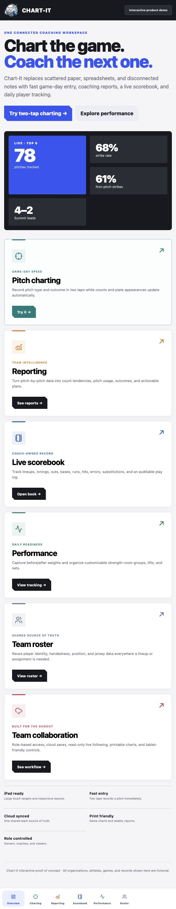
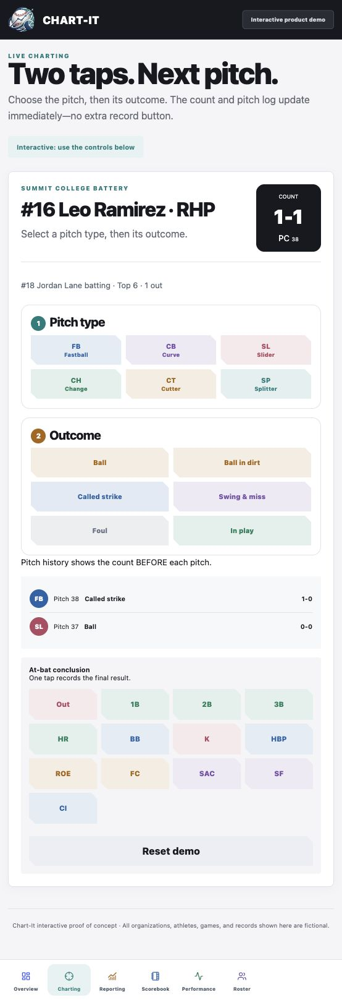
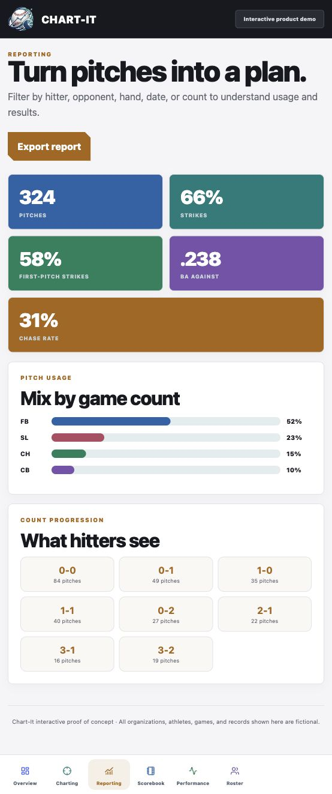
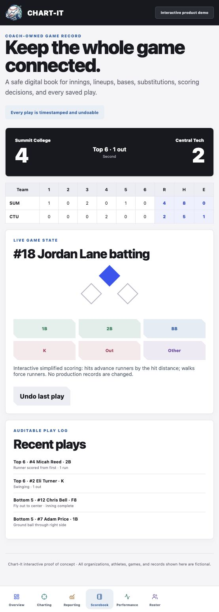
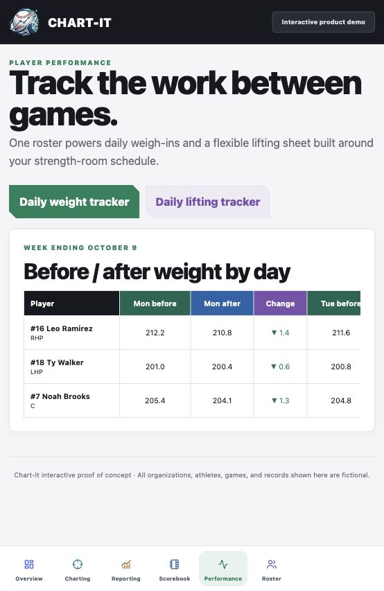
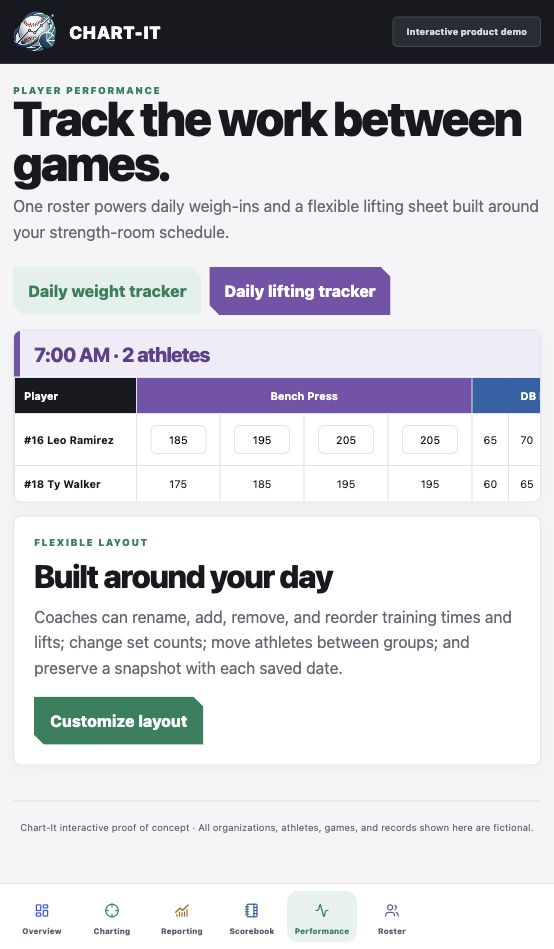
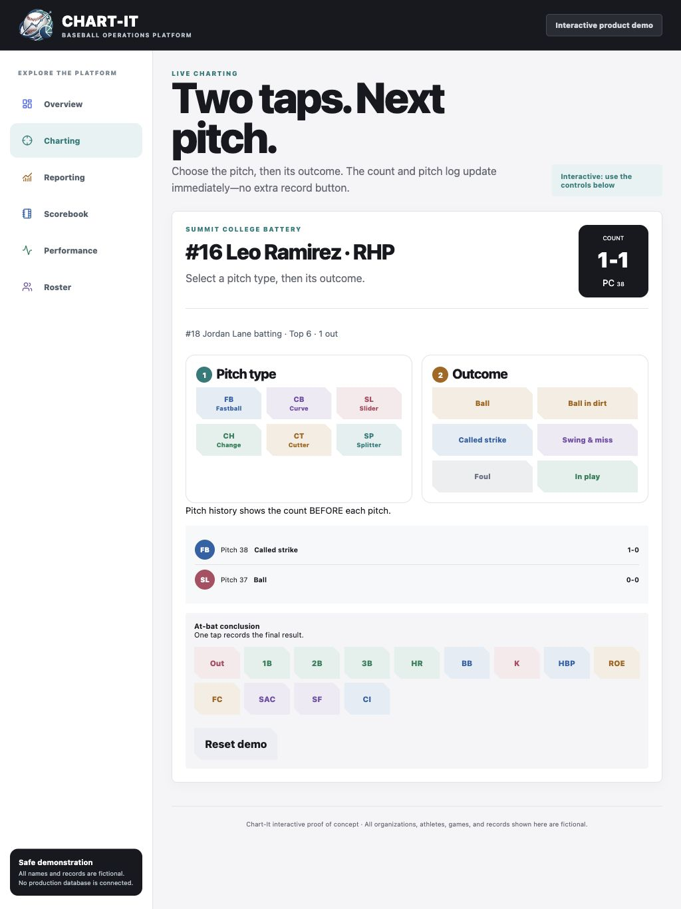
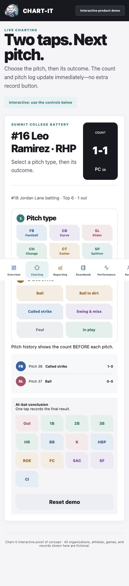

# Chart-It · Baseball coaching workspace

**Chart the game. Coach the next one.**

Built by [Kevin Smith](https://github.com/KwSmith12), a software builder and baseball coach, around fast game-day input and practical player-development workflows.

## One connected coaching workspace

- **Pitch charting:** two-tap pitch entry, live counts, pitch history, and plate-appearance results.
- **Reporting:** pitch usage, count tendencies, first-pitch strikes, and coaching insights.
- **Scorebook:** innings, bases, scores, lineups, and a coach-owned play record.
- **Performance:** daily before/after weights and flexible lifting schedules.
- **Roster:** shared player identities across coaching tools.
- **Tablet and phone layouts:** touch-oriented controls for the dugout.

## Product tour

| Pitch charting | Reporting |
| --- | --- |
|  |  |

| Scorebook | Weight tracking |
| --- | --- |
|  |  |

View iPad and phone screenshots

## Development status and privacy

Chart-It is in active development for college baseball coaching. These screenshots show a standalone proof of concept, not production team records. All displayed athletes, organizations, games, and measurements are fictional.

The demo offers two-tap entry, next-hitter progression, sample CSV export, simplified scoring with undo, and workout layout editing. Demo state resets on reload; reports and weight tables use sample values. Advanced scoring, cloud synchronization, permissions, and persistence belong to the live application and are not demonstrated here.

This public repository contains marketing screenshots and a static gallery only. Application source code, real rosters, and team data remain private.

**Interested in a walkthrough?** Connect with [Kevin Smith on LinkedIn](https://www.linkedin.com/in/kevinsmithdev/).
